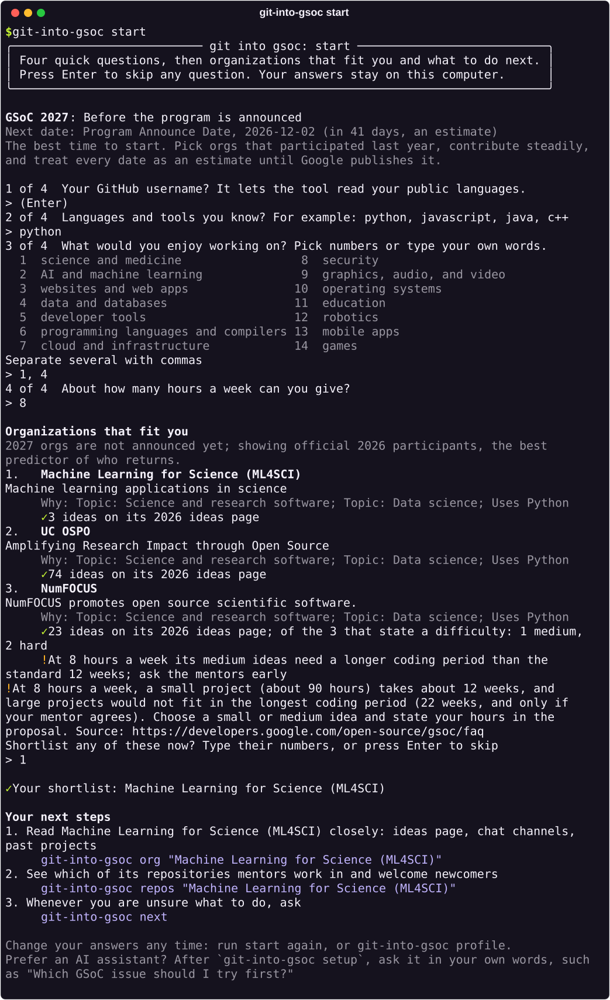

<p align="center">
  <picture>
    <source media="(prefers-color-scheme: dark)" srcset="brand/readme/banner-dark.svg">
    
  </picture>
</p>

<p align="center">
  <a href="https://github.com/anandkaranubc/git-into-gsoc/actions/workflows/ci.yml"></a>
  <a href="https://pypi.org/project/git-into-gsoc/"></a>
  
  <a href="LICENSE"></a>
</p>

# git-into-gsoc

**Find your first open-source contribution and prepare for [Google Summer of Code](https://summerofcode.withgoogle.com) (GSoC), using real data instead of guesses.**

Every year, many first-timers end up in a project that stopped answering, ask for an issue three people already claimed, or send a proposal that reads like a hundred others. git-into-gsoc reads the official GSoC site, the organization archive, and GitHub, and shows you:

- which **organizations** fit what you know and what you care about
- which of their **repositories** actually merge newcomers' pull requests (proposed changes)
- which **beginner issues** (reported bugs or tasks) nobody has claimed yet
- where the program is **right now**, and what to do this week

It works in your terminal and inside AI assistants such as Claude Code, Codex, Cursor, and VS Code. It never invents organizations, issues, or dates, and it never helps anyone send spam.

## Start in two minutes

**1. Install.** On macOS, Linux, or Windows with WSL, open a terminal and run:

```bash
curl -fsSL https://raw.githubusercontent.com/anandkaranubc/git-into-gsoc/main/install.sh | bash
```

On Windows PowerShell:

```powershell
irm https://raw.githubusercontent.com/anandkaranubc/git-into-gsoc/main/install.ps1 | iex
```

You only need an internet connection. If something is missing, the installer offers [uv](https://docs.astral.sh/uv/), a free tool that brings its own Python. It tells you exactly what it changed and connects every AI assistant it finds. [Other ways to install](docs/guide/02-install.md).

Already use uv or pipx? Install the [package from PyPI](https://pypi.org/project/git-into-gsoc/), the Python Package Index, then connect your assistants:

```bash
uv tool install git-into-gsoc    # or: pipx install git-into-gsoc
git-into-gsoc setup
```

**2. Answer four questions** in a new terminal:

```bash
git-into-gsoc start
```

You get the organizations that fit you, a shortlist, and your next steps with the exact commands. Press Enter to skip any question.

<p align="center">
  
</p>

**3. Come back any time.** `git-into-gsoc` on its own shows your progress. `git-into-gsoc next` tells you what to do now: deadlines, changes on the issues you follow, and new beginner issues.

> [!TIP]
> Searching issues uses GitHub's API, which allows only 60 requests an hour without signing in. Install [GitHub's `gh` tool](https://cli.github.com/) and run `gh auth login` once; git-into-gsoc picks it up by itself. Nothing else needs an account.

## Use it in your AI assistant

The installer already connects the assistants it finds. To add git-into-gsoc as a plugin that updates with your assistant instead, run one line. You need [uv](https://docs.astral.sh/uv/), a free tool that starts the git-into-gsoc server your assistant talks to.

| Assistant | Command |
|---|---|
| Claude Code | `claude plugin install git-into-gsoc --marketplace anandkaranubc/git-into-gsoc` |
| Codex | `codex plugin marketplace add anandkaranubc/git-into-gsoc`, then `codex plugin add git-into-gsoc@git-into-gsoc` |
| GitHub Copilot CLI | `copilot plugin marketplace add anandkaranubc/git-into-gsoc`, then `copilot plugin install git-into-gsoc@git-into-gsoc` |
| Gemini CLI (paid plans; on a free Google account use Antigravity) | `gemini extensions install https://github.com/anandkaranubc/git-into-gsoc --auto-update` |
| Antigravity | `agy plugin install https://github.com/anandkaranubc/git-into-gsoc` |
| VS Code, Cursor, Windsurf, and others | [Setup for each assistant](docs/assistants.md) |

Then ask in your own words, for example: *"I want to do Google Summer of Code. I know Python and like science. Where do I start?"* The assistant uses the same live data as the terminal and shows its sources.

One-click buttons for the server alone. They run the newest release from PyPI:

<!-- generated:install-links -->
[](https://cursor.com/en/install-mcp?name=git-into-gsoc&config=eyJjb21tYW5kIjoidXZ4IiwiYXJncyI6WyJnaXQtaW50by1nc29jQGxhdGVzdCIsIm1jcCJdfQ%3D%3D) [](https://vscode.dev/redirect/mcp/install?name=git-into-gsoc&config=%7B%22type%22%3A%22stdio%22%2C%22command%22%3A%22uvx%22%2C%22args%22%3A%5B%22git-into-gsoc%40latest%22%2C%22mcp%22%5D%7D) [](https://vscode.dev/redirect/mcp/install?name=git-into-gsoc&config=%7B%22type%22%3A%22stdio%22%2C%22command%22%3A%22uvx%22%2C%22args%22%3A%5B%22git-into-gsoc%40latest%22%2C%22mcp%22%5D%7D&quality=insiders) [](https://kiro.dev/launch/mcp/add?name=git-into-gsoc&config=%7B%22command%22%3A%22uvx%22%2C%22args%22%3A%5B%22git-into-gsoc%40latest%22%2C%22mcp%22%5D%7D)
<!-- /generated:install-links -->

## From zero to a first pull request

Each step names the command that does it. The [beginner guide](docs/README.md) walks through all of them with explanations and expected results.

| Step | Command | What you get |
|---|---|---|
| Find your fit | `git-into-gsoc start` | Three organizations that match you, with reasons |
| Look closer | `git-into-gsoc org "NumFOCUS" --shortlist` | Ideas page, chat channels, and past projects, saved to your shortlist |
| Pick a repository | `git-into-gsoc repos "NumFOCUS"` | Its repositories ranked by mentor activity and open beginner issues |
| Check it welcomes you | `git-into-gsoc repo OWNER/NAME --track` | Whether outside contributors' pull requests get merged, and how fast |
| Get your bearings | `git-into-gsoc orient OWNER/NAME` | Where the code lives, the test command CI runs, and the house rules |
| Find a free issue | `git-into-gsoc issues --repo OWNER/NAME` | Beginner issues with no linked pull request, assignee, or recent claim |
| Check before you comment | `git-into-gsoc issue OWNER/NAME#123 --track` | Claims, linked pull requests, and what to read first |
| Open your pull request | `git-into-gsoc pr-check OWNER/NAME#456` | Your pull request checked against the project's own rules |
| Write your proposal | `git-into-gsoc proposal draft.md` | What organizations reject proposals for, with evidence |

`OWNER/NAME` and the numbers are placeholders for the repository and issue you choose. Every command takes `--output json` for scripts, and `git-into-gsoc --help` lists all of them.

## Why you can trust what it says

- **Evidence over guesses.** Organizations come from the official list and the public archive. Dates come from the official site, and future years are labelled as estimates. Each result says why it was ranked where it is.
- **Free means free.** Issue availability comes from the issue's own timeline: linked pull requests, assignees, and "can I work on this?" claims with their dates.
- **Read-only and private.** It only reads public data and never posts anywhere. Your profile and progress stay in a file on your computer. There is no account, no tracking, and no telemetry. See [privacy](docs/privacy.md) and [sources and limitations](docs/sources.md).
- **No shortcuts.** It will not mass-message maintainers, farm trivial pull requests, or write your proposal. It points you to each organization's [AI policy](https://developers.google.com/open-source/gsoc/resources/ai_guidance) and helps you do work you can explain.

## Where to go next

| I want to... | Start here |
|---|---|
| Understand GSoC and open source first | [Beginner guide](docs/README.md) |
| Connect a specific AI assistant | [Assistant setup](docs/assistants.md) |
| Look up a command | [Command reference](docs/cli.md) |
| See the tools assistants get | [MCP reference](docs/mcp.md) |
| Fix a setup problem | [Troubleshooting](docs/troubleshooting.md) |
| Ask a question or tell us how it went | [Open an issue](https://github.com/anandkaranubc/git-into-gsoc/issues/new/choose) |

## Help build it

git-into-gsoc is made for people taking their first steps in open source, and it is a good place to take one. Fixing a confusing sentence counts. So does reporting a command that did not work for you.

- Start with [CONTRIBUTING.md](CONTRIBUTING.md). Setup takes a few minutes, and no previous open-source experience is needed.
- Pick an issue labelled [good first issue](https://github.com/anandkaranubc/git-into-gsoc/labels/good%20first%20issue).
- Read the [architecture](docs/architecture.md) to see how the terminal tool, the assistant server, and the skill share one core.

If git-into-gsoc helped you, the most useful thing you can do is [tell us](https://github.com/anandkaranubc/git-into-gsoc/issues/new/choose) what worked and what did not. Then tell a friend who is starting out.

## License and disclaimer

MIT, see [LICENSE](LICENSE).

This independent project is not affiliated with or endorsed by Google. Google Summer of Code and GSoC are trademarks of Google LLC. Always check dates, organizations, and rules on the [official program site](https://summerofcode.withgoogle.com).

<!-- mcp-name: io.github.anandkaranubc/git-into-gsoc -->
