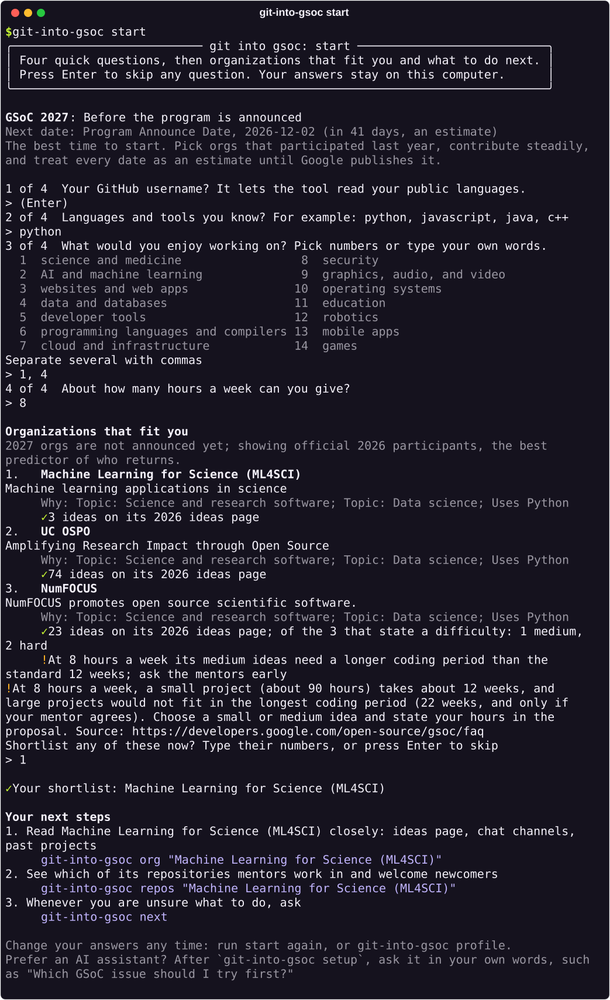

<p align="center">
  <picture>
    <source media="(prefers-color-scheme: dark)" srcset="brand/readme/banner-dark.svg">
    
  </picture>
</p>

<p align="center">
  <a href="https://github.com/anandkaranubc/git-into-gsoc/actions/workflows/ci.yml"></a>
  <a href="https://pypi.org/project/git-into-gsoc/"></a>
  
  <a href="LICENSE"></a>
</p>

# git-into-gsoc

**Find the [Google Summer of Code](https://summerofcode.withgoogle.com) (GSoC) organizations that fit you, the repositories that merge newcomers' pull requests, and the beginner issues nobody has claimed, with the evidence for each.**

[Try it in your browser](https://gitintogsoc.me/start/) · [Install it](docs/guide/02-install.md) · [Connect your AI assistant](docs/assistants.md) · [Read the beginner guide](docs/README.md)

Every season, many first-timers end up in a project that stopped answering, under an issue three people already claimed, or with a proposal that reads like a hundred others. The information to avoid that exists. It is just scattered across the official GSoC site, hundreds of ideas pages, and thousands of issue threads.

git-into-gsoc reads those sources for you and answers the questions newcomers actually ask:

| You ask | It checks |
|---|---|
| Which organizations fit me? | The official list of organizations, each one's ideas page, and its past years in the archive |
| Will this project merge my work? | Whether outside contributors' pull requests (proposed changes) got merged recently, and how fast |
| Is this issue really free? | The issue's own history: linked pull requests, assignees, and "can I work on this?" comments with their dates |
| What should I do this week? | The program calendar, your shortlist, and the issues you follow |

It reads GitHub, and GitLab for most checks. It never invents an organization, an issue, or a date.

## Three ways to start

### In your browser, with nothing to install

Answer four questions on the [start page](https://gitintogsoc.me/start/) and get three organizations with the reasons they fit. The ranking is the terminal tool's own code running in your browser, on a snapshot of the official list, so your answers never leave the page. The first visit downloads about 8 MB. You can also [browse every organization](https://gitintogsoc.me/orgs/).

### In your terminal, for the whole journey

On macOS, Linux, or Windows with [WSL](https://learn.microsoft.com/en-us/windows/wsl/install) (Windows Subsystem for Linux):

```bash
curl -fsSL https://raw.githubusercontent.com/anandkaranubc/git-into-gsoc/main/install.sh | bash
```

On Windows PowerShell:

```powershell
irm https://raw.githubusercontent.com/anandkaranubc/git-into-gsoc/main/install.ps1 | iex
```

You need only an internet connection. If Python is missing, the installer offers [uv](https://docs.astral.sh/uv/), a free tool that brings its own Python, and uv adds its folder to your shell's startup file. The installer says what it installs and connects every AI assistant it finds. The [install guide](docs/guide/02-install.md) has the other ways, a preview option, and how to update or remove it.

Already use uv or pipx? Install the [package from PyPI](https://pypi.org/project/git-into-gsoc/), then connect your assistants:

```bash
uv tool install git-into-gsoc    # or: pipx install git-into-gsoc
git-into-gsoc setup
```

Then open a new terminal and run the command below. It asks four questions like the start page, with your GitHub username in place of your experience. Press Enter to skip any of them.

```bash
git-into-gsoc start
```

<p align="center">
  
</p>

### In your AI assistant

To add git-into-gsoc as a plugin that updates with your assistant, run one line. Plugins need [uv](https://docs.astral.sh/uv/) to start the git-into-gsoc server, which your assistant talks to through MCP (the Model Context Protocol, the standard way AI assistants use outside tools). For Claude Code:

```bash
claude plugin install git-into-gsoc --marketplace anandkaranubc/git-into-gsoc
```

[Use it in your AI assistant](docs/assistants.md) has the line for Codex, GitHub Copilot CLI, Gemini CLI, Antigravity, VS Code, Cursor, Windsurf, and Claude Desktop, and how to update or remove each one.

Then ask in your own words, for example: *"I want to do Google Summer of Code. I know Python and like science. Where do I start?"* The assistant answers from the same live data as the terminal and shows its sources.

One-click buttons add only the server, without the skill (the written guidance that teaches your assistant the GSoC journey). They need uv too, and each installs the newest release:

<!-- generated:install-links -->
[](https://cursor.com/install-mcp?name=git-into-gsoc&config=eyJjb21tYW5kIjoidXZ4IiwiYXJncyI6WyJnaXQtaW50by1nc29jQGxhdGVzdCIsIm1jcCJdfQ%3D%3D) [](https://vscode.dev/redirect/mcp/install?name=git-into-gsoc&config=%7B%22type%22%3A%22stdio%22%2C%22command%22%3A%22uvx%22%2C%22args%22%3A%5B%22git-into-gsoc%40latest%22%2C%22mcp%22%5D%7D) [](https://vscode.dev/redirect/mcp/install?name=git-into-gsoc&config=%7B%22type%22%3A%22stdio%22%2C%22command%22%3A%22uvx%22%2C%22args%22%3A%5B%22git-into-gsoc%40latest%22%2C%22mcp%22%5D%7D&quality=insiders) [](https://kiro.dev/launch/mcp/add?name=git-into-gsoc&config=%7B%22command%22%3A%22uvx%22%2C%22args%22%3A%5B%22git-into-gsoc%40latest%22%2C%22mcp%22%5D%7D) [](https://vs-open.link/mcp-install?%7B%22name%22%3A%22git-into-gsoc%22%2C%22type%22%3A%22stdio%22%2C%22command%22%3A%22uvx%22%2C%22args%22%3A%5B%22git-into-gsoc%40latest%22%2C%22mcp%22%5D%7D) [](https://github.com/anandkaranubc/git-into-gsoc/releases/latest/download/git-into-gsoc.mcpb)
<!-- /generated:install-links -->

## From first look to first pull request

Each step is one command. The [beginner guide](docs/README.md) explains every step and what to expect, and the [website](https://gitintogsoc.me/) shows recorded runs of several of them.

| Step | Command | What you get |
|---|---|---|
| Find your fit | `git-into-gsoc start` | Three organizations, each with the reasons it fits you |
| Read one closely | `git-into-gsoc org "NumFOCUS" --shortlist` | Its ideas page, chat channels, and past projects, saved to your shortlist |
| Pick a repository | `git-into-gsoc repos "NumFOCUS"` | Its repositories ranked by ideas-page mentions, beginner issues, and activity |
| Check it welcomes you | `git-into-gsoc repo OWNER/NAME --track` | Whether newcomers' pull requests get merged here, and how fast |
| Get your bearings | `git-into-gsoc orient OWNER/NAME` | Where the code lives, the test command its automatic checks run, and the house rules |
| Find a free issue | `git-into-gsoc issues --repo OWNER/NAME` | Beginner issues with no linked pull request, assignee, or recent claim |
| Check before you comment | `git-into-gsoc issue OWNER/NAME#123 --track` | Claims, linked pull requests, assignees, and recent activity |
| Open your pull request | `git-into-gsoc pr-check OWNER/NAME#456` | Your pull request checked against the project's own rules |
| Write your proposal | `git-into-gsoc proposal draft.md` | What organizations reject proposals for, checked against your draft |
| Come back any time | `git-into-gsoc next` | Deadlines, changes on the issues you follow, and new beginner issues |

`OWNER/NAME` and the numbers are placeholders for the repository and issue you choose. `git-into-gsoc --help` lists every command, and most take `--output json` for scripts.

> [!TIP]
> These steps use GitHub's API, which allows only 60 requests an hour without signing in, and one pass through the table can use most of them. If you install [GitHub's `gh` tool](https://cli.github.com/) and run `gh auth login` once, git-into-gsoc picks it up by itself. Nothing else needs an account.

## Why you can trust what it says

- **Evidence, not guesses.** Organizations come from the official list and the public archive, and dates from the official site. Every ranked result says why it ranks where it does, and where that reason came from.
- **Honest about limits.** A fit says how well the work matches you, never your chance of being accepted. Dates for a year Google has not announced are labelled as estimates. [Sources and limitations](docs/sources.md) says what each source cannot tell you.
- **Private by default.** The tool reads only public data and never posts, comments, or opens anything for you. Your profile and progress stay in a file on your computer, and the tool sends no telemetry. The website counts page views without cookies. [Privacy](docs/privacy.md) has the details.
- **No shortcuts.** It will not mass-message maintainers, farm trivial pull requests, or write your proposal. It points you to each organization's [AI policy](https://developers.google.com/open-source/gsoc/resources/ai_guidance) and helps you do work you can explain.

## How it compares

| If you already use | What this adds |
|---|---|
| [GSoC Organizations](https://www.gsocorganizations.dev/), the community archive of past organizations | A ranking for your skills and interests, the repositories inside each organization that merge newcomers' work, and the beginner issues that are still free. The archive is one of this tool's sources |
| Archives of accepted proposals | Links to them from `ideas`, next to each organization's own ideas page and its AI policy |
| [goodfirstissue.dev](https://goodfirstissue.dev/), [up-for-grabs](https://up-for-grabs.net/), and other label feeds | A read of each issue's history, so you skip the issue three people already claimed |
| An AI assistant on its own | Real organizations, issues, and dates in place of guesses, with their sources |

[What we learned from other tools](docs/research.md) has the full comparison, with sources.

## Where to go next

| I want to... | Start here |
|---|---|
| Understand GSoC and open source first | [Beginner guide](docs/README.md) |
| Look up a command | [Command reference](docs/cli.md) |
| See the tools my assistant gets | [MCP reference](docs/mcp.md) |
| Know how organizations are ranked | [How recommendations work](docs/recommendations.md) |
| Fix a setup problem | [Troubleshooting](docs/troubleshooting.md) |
| Ask a question | [Open an issue](https://github.com/anandkaranubc/git-into-gsoc/issues/new/choose) |

## Help build it

git-into-gsoc is made for people taking their first steps in open source, and it is a good place to take one. Fixing a confusing sentence counts. So does reporting a command that did not work for you.

- Start with [CONTRIBUTING.md](CONTRIBUTING.md). Setup takes a few minutes, and no previous open-source experience is needed.
- Look through the [open issues](https://github.com/anandkaranubc/git-into-gsoc/issues). Ones labelled good first issue go quickly, so if none is free, a confusing sentence in the docs makes a fine first change.
- Read the [architecture](docs/architecture.md) to see how the terminal tool, the assistant server, and the skill share one Python core.

If git-into-gsoc helped you, the most useful thing you can do is [tell us](https://github.com/anandkaranubc/git-into-gsoc/issues/new?template=feedback.yml) what worked and what did not. It opens a public GitHub issue, so leave out anything private. Then tell a friend who is starting out.

## License and disclaimer

MIT, see [LICENSE](LICENSE).

This independent project is not affiliated with or endorsed by Google. Google Summer of Code and GSoC are trademarks of Google LLC. Always check dates, organizations, and rules on the [official program site](https://summerofcode.withgoogle.com).

<!-- mcp-name: io.github.anandkaranubc/git-into-gsoc -->
